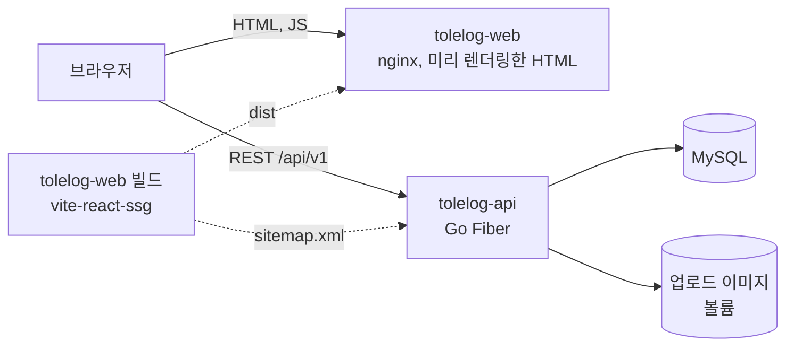

# 아키텍처

## 시스템 구성

| 저장소 | 역할 |
|---|---|
| tolelog-web(이 저장소) | 웹 프론트엔드, 공개 페이지 미리 렌더링 |
| [tolelog-api](https://github.com/tolelom/tolelog-api) | REST API, 인증, 이미지 업로드, RSS, 사이트맵 |

## 미리 렌더링

공개 페이지는 빌드 시점에 HTML로 만듭니다(SSG). 빌드가 tolelog-api의 `/sitemap.xml`에서 글(`/post/`), 사용자(`/user/`), 시리즈(`/series/`) 경로를 찾아 정적 라우트와 함께 렌더링하고, 브라우저는 받은 HTML을 React로 하이드레이션합니다. 에디터, 설정, 임시저장 목록처럼 로그인이 필요한 화면은 미리 렌더링하지 않습니다.

sitemap 주소는 `VITE_SSG_API_URL`, `VITE_API_URL`, https://api.tolelom.xyz 순서로 정합니다. sitemap을 받지 못하면 정적 라우트만 만듭니다.

## 코드 지도

| 경로 | 책임 |
|---|---|
| `src/App.tsx` | 라우트 정의. 공개 라우트는 SSG 대상, 인증 라우트는 `PrivateRoute` |
| `src/pages` | 화면 단위 컴포넌트(홈, 글 상세, 에디터, 시리즈, 프로필, 설정 등) |
| `src/components` | 에디터, 댓글, 내비게이션, 메타 태그 등 공용 컴포넌트 |
| `src/context` | 인증, 테마, 토스트 상태 |
| `src/hooks` | 자동 저장, 목차, 좋아요, 시리즈 내비게이션 등 |
| `src/lib` | 도메인과 무관한 기반 코드: `api/`(API 클라이언트·캐시·서버 입력 한도), 설정 상수, 토스트 알림, 오류 보고, 날짜 형식, 주소 헬퍼 |
| `src/features` | 컴포넌트·훅이 아닌 기능별 로직: `markdown/`(파서·렌더러, highlight.js·KaTeX·DOMPurify), `posts/`(목록·메타·요약·슬러그·태그·입력 검사), `images/`(Canvas 리사이즈·압축·업로드), `auth/`(입력 검사) |
| `src/types` | API 타입(`api.gen.ts` 생성 파일의 별칭)과 마크다운 블록·에디터 타입 |
| `api-contract/swagger.json` | tolelog-api Swagger 사본(API 계약) |
| `vite.config.ts` | SSG 대상 경로 결정(sitemap 조회, 인증 라우트 제외) |
| `scripts/decode-ssg-filenames.mjs` | 미리 렌더링한 파일 이름의 퍼센트 인코딩을 풀어 한글 경로를 nginx가 찾게 함 |
| `nginx.conf`, `nginx/` | 정적 파일 서빙, gzip, 캐시, 보안 헤더 |

## 지켜야 할 규칙

- 로그인이 필요한 라우트를 추가하면 `vite.config.ts`의 `PRIVATE_ROUTES`에도 넣습니다. 미리 렌더링하지 않은 경로는 nginx가 홈 HTML로 대신 응답해 하이드레이션이 어긋납니다.
- `src/types/api.gen.ts`는 생성 파일이라 직접 고치지 않습니다. 절차는 `CONTRIBUTING.md` 「API 계약」에 있습니다.
- `src/features/posts/slug.ts`의 글 경로는 tolelog-api `internal/permalink`와 같은 결과를 내야 합니다.
