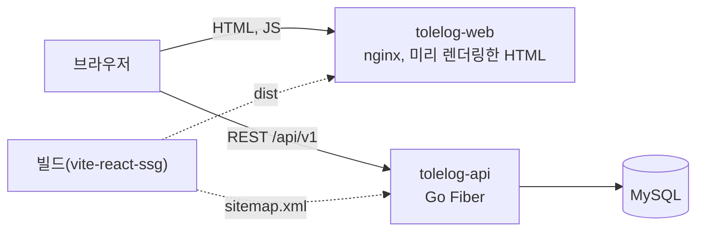
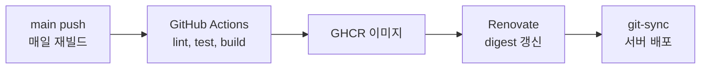

# Tolelog Web

> 개인 블로그 플랫폼의 웹 프론트엔드

React 19 · TypeScript · Vite 7 · vite-react-ssg · 서비스 https://blog.tolelom.xyz

## 개요

Tolelog는 마크다운으로 글을 쓰고 시리즈로 묶어 발행하는 블로그 플랫폼이다. 이 저장소는 그 웹 프론트엔드로, 글 목록과 상세, 블록 기반 마크다운 에디터, 댓글, 좋아요, 시리즈, 프로필 화면을 제공한다.

공개 페이지는 빌드 시점에 HTML로 미리 렌더링한다(SSG). 빌드가 백엔드의 `sitemap.xml`을 읽어 공개 글, 사용자, 시리즈 경로를 찾고, 각 경로를 정적 HTML로 만든다. 브라우저는 이 HTML을 받은 뒤 React로 하이드레이션한다. 에디터, 설정, 임시저장 목록처럼 로그인이 필요한 화면은 미리 렌더링하지 않는다.

새 글이 미리 렌더링 결과에 들어가도록 CI가 매일 한 번 다시 빌드한다.

## 시스템 구성





| 저장소 | 역할 |
|---|---|
| tolelog-web | 웹 프론트엔드(이 저장소) |
| [tolelog-api](https://github.com/tolelom/tolelog-api) | REST API, 인증, 이미지 업로드, RSS, 사이트맵 |

## 기능

- 블록 기반 마크다운 에디터: 편집 중인 블록만 원문으로, 나머지는 렌더링해 표시. 자동 저장, 임시저장 목록, 미리보기
- 마크다운 렌더링: 표, 각주, 코드 하이라이트(highlight.js), 수식(KaTeX), HTML 정제(DOMPurify)
- 이미지 업로드: 브라우저에서 Canvas로 리사이즈와 압축 후 업로드
- 글 상세의 목차, 시리즈 이전/다음 이동
- 댓글, 좋아요, 태그 자동완성과 태그 필터, 검색
- 사용자 프로필, 아바타, 비밀번호 변경, 계정 삭제
- 다크/라이트 테마
- 페이지별 메타 태그와 구조화 데이터(SEO)
- Sentry 오류 보고(DSN 설정 시)

## 구조

| 경로 | 책임 |
|---|---|
| `src/App.tsx` | 라우트 정의. 공개 라우트는 SSG 대상, 인증 라우트는 `PrivateRoute` |
| `src/pages` | 화면 단위 컴포넌트(홈, 글 상세, 에디터, 시리즈, 프로필, 설정 등) |
| `src/components` | 에디터, 댓글, 내비게이션, 메타 태그 등 공용 컴포넌트 |
| `src/context` | 인증, 테마, 토스트 상태 |
| `src/hooks` | 자동 저장, 목차, 좋아요, 시리즈 내비게이션 등 |
| `src/lib` | 도메인과 무관한 기반 코드: `api/`(API 클라이언트·캐시·서버 입력 한도), 설정 상수, 토스트 알림, 오류 보고, 날짜 형식, 주소 헬퍼 |
| `src/features` | 컴포넌트·훅이 아닌 기능별 로직: `markdown/`(파서·렌더러), `posts/`(목록·메타·요약·슬러그·태그·입력 검사), `images/`(압축·업로드), `auth/`(입력 검사) |
| `src/types` | API 타입(`api.gen.ts` 생성 파일의 별칭)과 마크다운 블록·에디터 타입 |
| `api-contract/swagger.json` | tolelog-api Swagger 사본(API 계약) |
| `vite.config.ts` | SSG 대상 경로 결정(sitemap 조회, 인증 라우트 제외) |
| `scripts/decode-ssg-filenames.mjs` | 미리 렌더링한 파일 이름의 퍼센트 인코딩을 풀어 한글 경로를 nginx가 찾게 함 |
| `nginx.conf`, `nginx/` | 정적 파일 서빙, gzip, 캐시, 보안 헤더 |

## 실행

Node.js와 로컬 [tolelog-api](https://github.com/tolelom/tolelog-api)가 필요하다.

```bash
git clone https://github.com/tolelom/tolelog-web.git
cd tolelog-web

npm install
cp .env.example .env
npm run dev
```

`.env.example`과 개발 서버 프록시는 API를 `localhost:3000`으로 본다. tolelog-api를 `PORT=3000`으로 띄우거나 `VITE_API_URL`을 바꾼다. `VITE_SSG_API_URL`이 없으면 빌드는 `VITE_API_URL`, 그것도 없으면 운영 API의 sitemap을 읽는다.

| 명령 | 용도 |
|---|---|
| `npm run dev` | 개발 서버 |
| `npm run build` | 타입 검사, SSG 빌드 |
| `npm run build:csr` | 미리 렌더링 없는 빌드 |
| `npm run test` | Vitest 테스트 |
| `npm run test:coverage` | 커버리지 포함 테스트 |
| `npm run lint` | ESLint |
| `npm run type-check` | TypeScript 타입 검사 |
| `npm run contract:sync` | tolelog-api 의 Swagger 를 가져와 API 타입을 다시 생성 |
| `npm run contract:types` | `api-contract/swagger.json` 에서 `src/types/api.gen.ts` 생성 |
| `npm run contract:check` | 생성된 타입이 스펙과 같은지 확인 |

## API 계약

API 요청·응답 타입의 원본은 tolelog-api 가 주석에서 생성하는 Swagger 2.0 문서(`docs/swagger.json`)다. 이 저장소는 그 사본을 `api-contract/swagger.json` 에 두고, 거기서 `src/types/api.gen.ts` 를 생성해 커밋한다(swagger2openapi → openapi-typescript). `src/types/index.ts` 의 API 타입은 생성된 타입의 별칭이다.

- 백엔드 응답이 바뀌면 `npm run contract:sync` 를 실행한다. 형제 디렉터리 `../tolelog-api` 가 있으면 그 파일을, 없거나 `-- --remote` 를 주면 GitHub main 의 파일을 받는다. 바뀐 사본과 생성 파일을 함께 커밋한다.
- 테스트(`scripts/__tests__/contract-types.test.ts`)가 생성 파일이 사본과 어긋나면 실패한다. 네트워크는 쓰지 않는다.
- 폼이 검사하는 입력 한도(`src/lib/api/limits.ts` — 비밀번호 72바이트, 태그 50자, 검색어 2~100자 등)는 스펙의 값과 같아야 하고, 테스트가 이를 확인한다.
